# LPC2148 ATM System — Project README

An embedded **Automated Teller Machine (ATM) Controller** built on the **LPC2148** microcontroller featuring a **16x2 character LCD**, **4x4 matrix keypad**, **Real-Time Clock (RTC)** with **EINT3 hardware interrupt** setup menus, **UART0** serial transaction/timestamp logging, **in-memory transaction history**, and **buzzer security alerts**[cite: 13, 14, 16, 17, 19].

---
## 🎯 Objectives

- Develop a bare-metal ATM simulator using the LPC2148 ARM7 microcontroller and Embedded C.
- Implement PIN-based authentication and a menu-driven interface using a 4×4 matrix keypad.
- Interface a 16×2 LCD for displaying menus, account information, and transaction status.
- Implement basic ATM operations such as balance inquiry, cash withdrawal, deposit, PIN change, and transaction history.
- Integrate the Real-Time Clock (RTC) to associate transaction records with date and time.
- Use UART serial communication for transaction logging and debugging.
- Understand peripheral interfacing, modular firmware design, interrupt handling, and hardware-level debugging.
  
## 1. Visual System Architecture

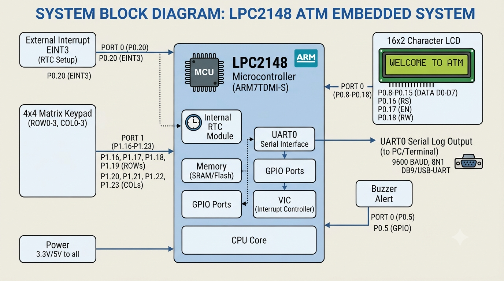

## 2. ATM & RTC Workflow at a Glance

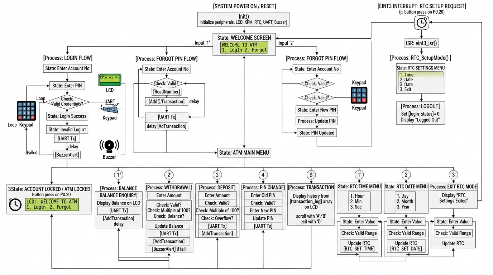

| Stage / Mode | Key Triggers & Rules | System Behavior |
| :--- | :--- | :--- |
| **Welcome Screen** | `'1'` -> Login, `'2'` -> Forgot PIN | Displays `"WELCOME TO ATM"` and `"1.Login 2.Forgot"` in a loop[cite: 16]. |
| **Login & Lockout** | Default Acc: `1001`, PIN: `1234`[cite: 16]; up to **3 attempts**[cite: 16] | Grants access to `atm_menu()` on match; locks account and triggers `BuzzerAlert()` on 3rd failed attempt[cite: 16]. |
| **Main ATM Menu** | `'1'`–`'6'` (`Bal`, `Withdraw`, `Dep`, `PIN`, `History`, `Logout`)[cite: 16] | Executes balance check, Rs.100-multiple withdrawal/deposit, PIN change, history browser, or logout[cite: 16]. |
| **Forgot PIN** | Account No + DOB (`13022005`) -> New PIN[cite: 16] | Verifies stored account number and DOB before updating `pin`[cite: 16]. |
| **RTC Setup (`EINT3`)** | Falling edge on `EINT3` (`P0.20`) -> `eint3_isr()`[cite: 13] | Opens `RTC_SetupMode()` (`1.Time`, `2.Date`, `3.Exit`) to update Hour/Min/Sec or Day/Month/Year[cite: 16]. |

---

## 3. Hardware Pinout & Interface Map

| Peripheral / Signal | MCU Port / Pin | Direction / Mode | Macro / Register Reference |
| :--- | :--- | :--- | :--- |
| **LCD Data Bus (D0–D7)** | `P0.8` – `P0.15`[cite: 6] | Output[cite: 17] | `LCD_DATA` (`8`), `WRITEBYTE(IOPIN0, LCD_DATA, byte)`[cite: 6, 17] |
| **LCD Register Select (RS)** | `P0.16`[cite: 6] | Output (`0`=Cmd, `1`=Data)[cite: 17] | `LCD_RS` (`16`)[cite: 6] |
| **LCD Enable (EN)** | `P0.17`[cite: 6] | Output (High-to-low strobe)[cite: 17] | `LCD_EN` (`17`)[cite: 6] |
| **LCD Read/Write (RW)** | `P0.18`[cite: 6] | Output (`0`=Write)[cite: 17] | `LCD_RW` (`18`)[cite: 6] |
| **Keypad Rows (R0–R3)** | `P1.16` – `P1.19`[cite: 5] | Output (Active-low scan)[cite: 14] | `ROW0`..`ROW3` (`16`..`19`), `IODIR1 \|= 15<<ROW0`[cite: 5, 14] |
| **Keypad Columns (C0–C3)** | `P1.20` – `P1.23`[cite: 5] | Input (Read nibble)[cite: 14] | `COL0`..`COL3` (`20`..`23`), `READNIBBLE(IOPIN1, COL0)`[cite: 5, 14] |
| **Buzzer Alert** | `P0.5`[cite: 16] | Output (2s active pulse)[cite: 16] | `BUZZER_PIN` (`(1U << 5)`), `IOSET0` / `IOCLR0`[cite: 16] |
| **External Interrupt 3** | `P0.20` (`EINT3`)[cite: 13] | Falling-edge IRQ (VIC Ch 17)[cite: 13] | `PINSEL1`, `EXTMODE`, `EXTPOLAR`, `EXTINT`, `VIC*`[cite: 13] |
| **UART0 Serial** | `TXD0` / `RXD0` (`P0.0`, `P0.1`)[cite: 19] | Serial TX / RX (`9600` baud)[cite: 11, 19] | `FOSC=12MHz`, `CCLK=60MHz`, `PCLK=15MHz`, `DIVISOR`[cite: 11] |

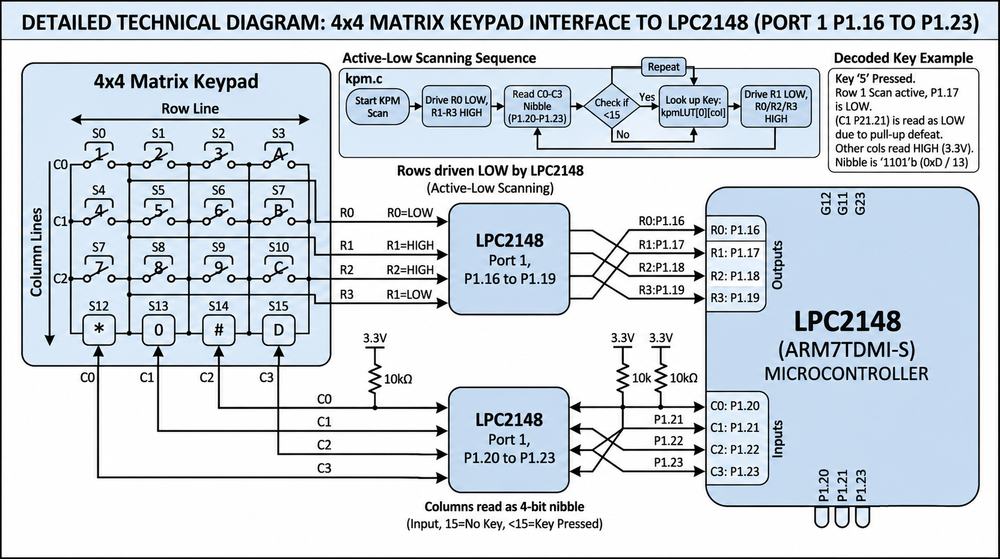
---

## 4. Keypad Controls & Key Map

### 4x4 Matrix Lookup Table (`kpmLUT[4][4]`)

| Row \ Col | Col 0 (`P1.20`) | Col 1 (`P1.21`) | Col 2 (`P1.22`) | Col 3 (`P1.23`) |
| :---: | :---: | :---: | :---: | :---: |
| **Row 0 (`P1.16`)** | `'1'` | `'2'` | `'3'` | `'A'` |
| **Row 1 (`P1.17`)** | `'4'` | `'5'` | `'6'` | `'B'` |
| **Row 2 (`P1.18`)** | `'7'` | `'8'` | `'9'` | `'C'` |
| **Row 3 (`P1.19`)** | `'*'` | `'0'` | `'#'` | `'D'` |

[cite: 5, 14]

### Special Action Keys by Context

| Key | In `ReadNumber()` (Numeric Entry) | In `transaction_history()` | In Menus (`atm_menu`, `RTC_*`) |
| :---: | :--- | :--- | :--- |
| `'0'`–`'9'` | Append digit (up to 10 digits)[cite: 16] | — | Menu option selection[cite: 16] |
| `'#'` | Confirm & convert input to `u32`[cite: 16] | — | — |
| `'*'` | Clear entire input buffer[cite: 16] | — | — |
| `'A'` | Delete last entered digit (backspace)[cite: 16] | Previous (older) transaction[cite: 16] | — |
| `'B'` | — | Next (newer) transaction[cite: 16] | — |
| `'D'` | Cancel entry (`INPUT_CANCEL`)[cite: 16] | Exit history viewer[cite: 16] | — |

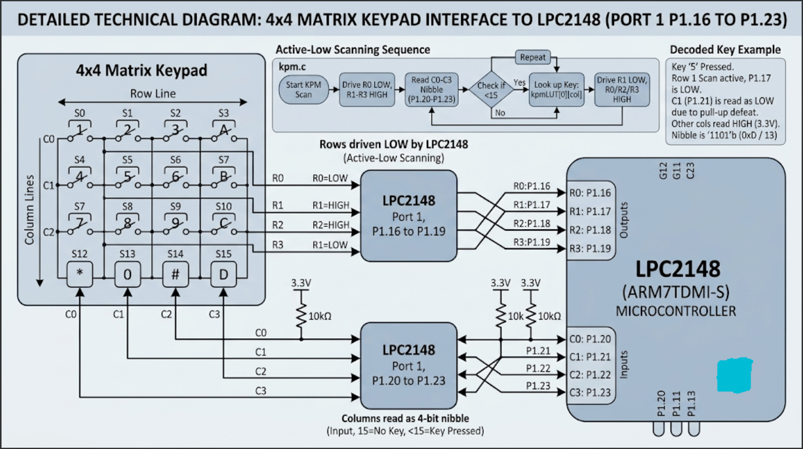
---

## 5. Project File & Module Guide

| File | Type | Responsibility & Key Functions / Macros |
| :--- | :--- | :--- |
| `atm.h`[cite: 1] | Header | Declares ATM screens, account actions, PIN flows, and RTC helpers[cite: 1]. |
| `atm.c`[cite: 16] | Source | Core ATM logic: `welcome`, `login`, `atm_menu`, `balance_enquiry`, `withdraw`, `deposit`, `change_pin`, `forgot_pin`, `AddTransaction`, `transaction_history`, `DisplayDateTime`, `UARTDateTime`, `RTC_SetupMode`, `InitBuzzer`, `BuzzerAlert`[cite: 16]. |
| `types.h`[cite: 9] | Header | Fixed-width/portable type aliases (`u8`, `s8`, `u16`, `s16`, `u32`, `s32`, `f32`, `s64`)[cite: 9]. |
| `defines.h`[cite: 2] | Header | Bitwise manipulation macros (`SETBIT`, `CLRBIT`, `CPLBIT`, `WRITEBIT`, `READBIT`, nibble/byte macros)[cite: 2]. |
| `delay.h`[cite: 3] & `delay.c`[cite: 12] | Driver | Busy-wait delays: `delay_us`, `delay_ms`, `delay_s`[cite: 3, 12]. |
| `lcd_defines.h`[cite: 6] & `lcd.c`[cite: 17] | Driver | HD44780 LCD commands, pin macros, and routines (`InitLCD`, `CmdLCD`, `CharLCD`, `StrLCD`, `U32LCD`, `S32LCD`, `F32LCD`, `BuildCGRAM`)[cite: 6, 17]. |
| `kpm_defines.h`[cite: 5] & `kpm.c`[cite: 14] / `kpm_2.c`[cite: 15] | Driver | 4x4 matrix keypad pin macros and scanning (`InitKPM`, `ColScan`, `RowCheck`, `ColCheck`, `KeyScan`)[cite: 5, 14]. |
| `rtc.h`[cite: 7] & `RTC_defines.h`[cite: 8] / `RTC_defines.c`[cite: 18] | Driver | RTC time/date declarations (`InitRTC`, `RTC_SET_TIME`, `RTC_SET_DATE`, `RTC_READ_TIME`, `RTC_READ_DATE`) and bit macros[cite: 7, 8, 18]. |
| `intrrupt.h`[cite: 4] & `intrrupt.c`[cite: 13] | Driver | Configures `EINT3` on `P0.20` (falling edge, VIC channel 17) and handles `eint3_isr`[cite: 4, 13]. |
| `uart.h`[cite: 10], `uart_defines.h`[cite: 11] & `uart.c`[cite: 19] | Driver | UART0 `9600` baud 8N1 driver (`UART0_Init`, `UART0_Tx`, `UART0_Rx`, `U0_TxStr`, `U0_TxU32`, `U0_TxS32`, `U0_TxF32`, `U0_RxStr`)[cite: 10, 11, 19]. |

---

## 6. Default Configuration & Business Rules

* **Initial Account Credentials**: Account `1001`, PIN `1234`, Balance `Rs.25000`, DOB `13022005` (`DDMMYYYY`)[cite: 16].
* **Withdrawal & Deposit Rules**: Must be non-zero and an exact multiple of `Rs.100`; withdrawals cannot exceed `balance`, and deposits guard against `u32` overflow[cite: 16].
* **Transaction History Capacity**: Stores up to `MAX_HISTORY = 10` entries (`HISTORY_LENGTH = 32` chars each), evicting the oldest entry when full[cite: 16].
* **Serial Output (`UART0`)**: Logs timestamps (`UARTDateTime`), login events, balance enquiries, withdrawals, deposits, PIN changes, and logout banners[cite: 16].

## Project Visual Showcase

### 1. Hardware Setup & Multi-Angle Views

| Complete & Overview | Front / Keypad & Top View | Side & Right Views |
| :---: | :---: | :---: |
| 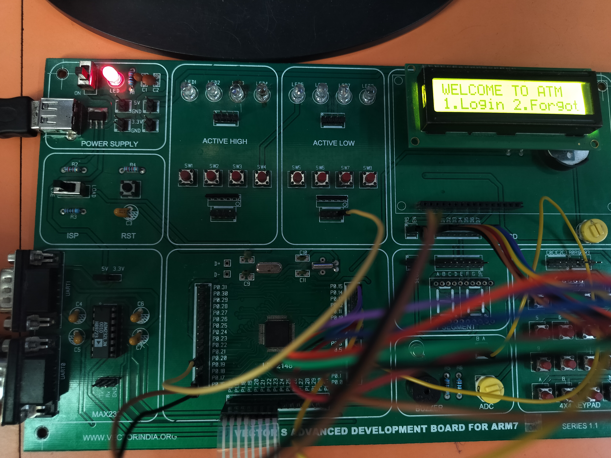 *Full ATM hardware assembly* | 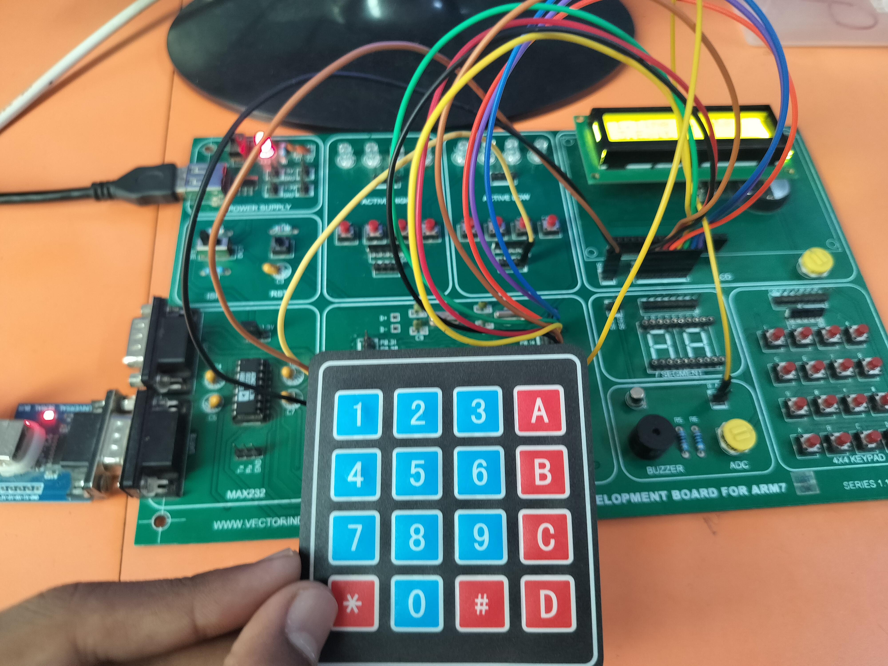 *Board integrated with 4x4 keypad* | 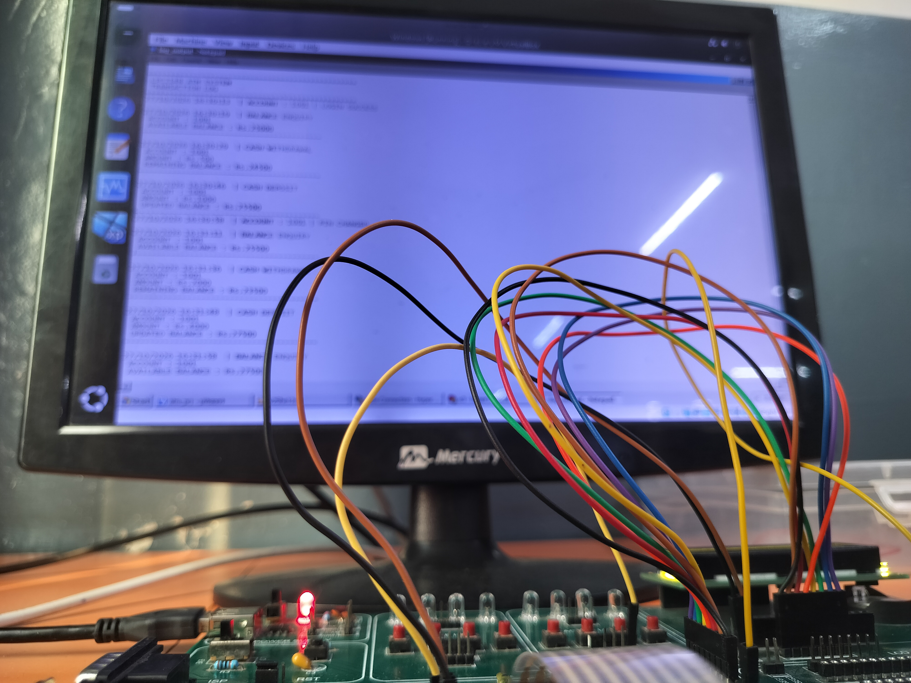 *Side view of hardware setup* |
| 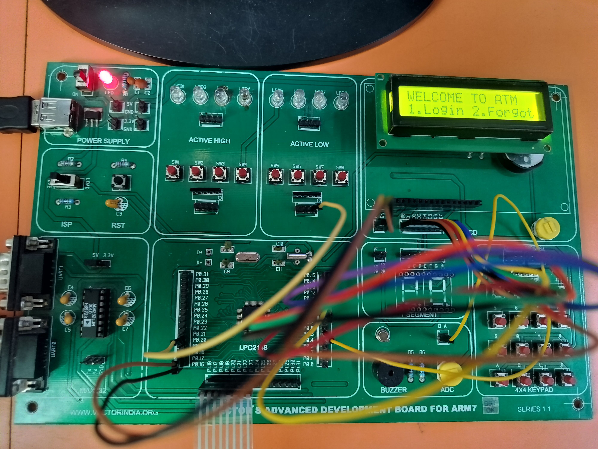 *LPC2148 board & peripherals* | 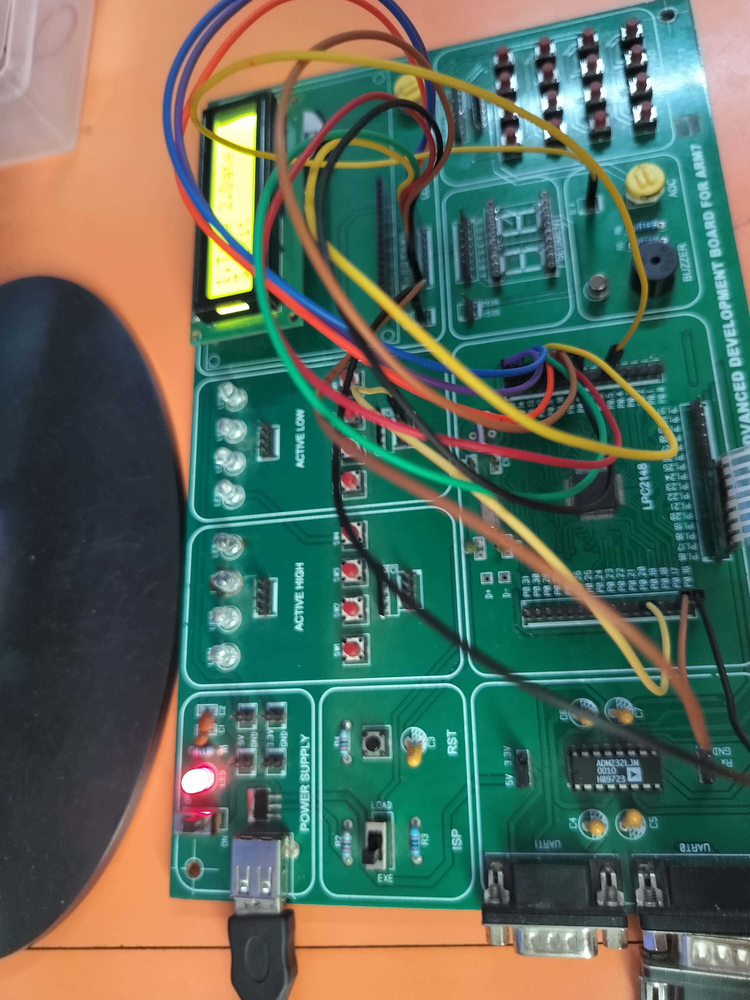 *Top view of wiring & connections* | 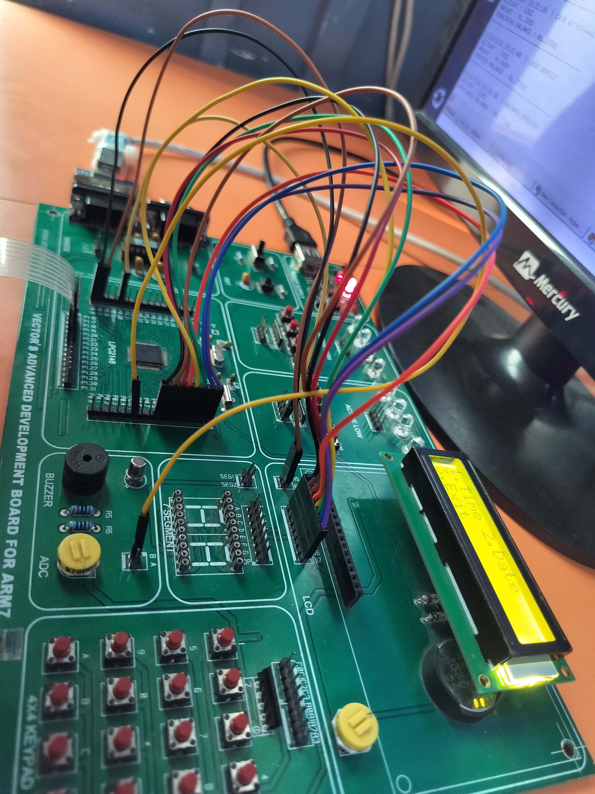 *Right-side view of hardware setup* |
---

### 2. LCD Screen & Transaction Flow

| Step | Screen / State | Preview | Description |
| :---: | :--- | :--- | :--- |
| **1** | **Welcome Screen** | 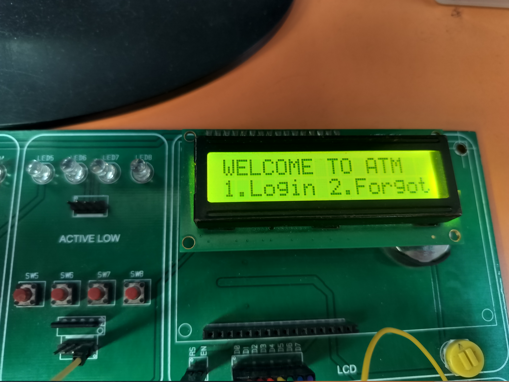 | Initial ATM welcome prompt on LCD[cite: 16, 24] |
| **2** | **Balance Enquiry** | 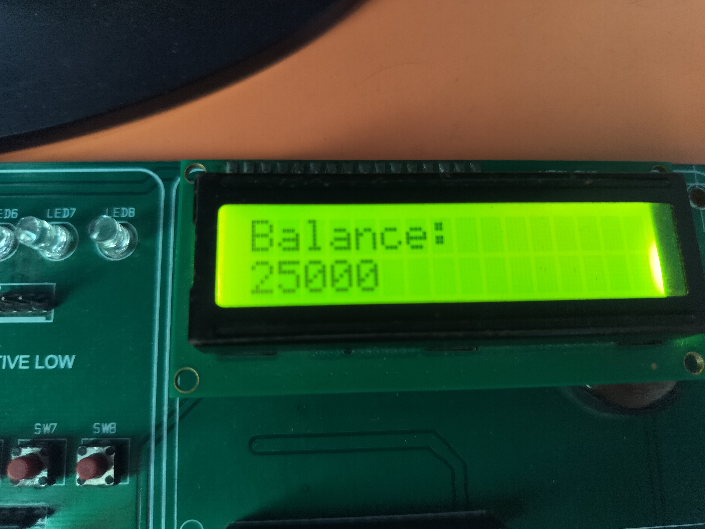 | Account balance displayed on LCD[cite: 16, 24] |
| **3** | **Amount Entered** | 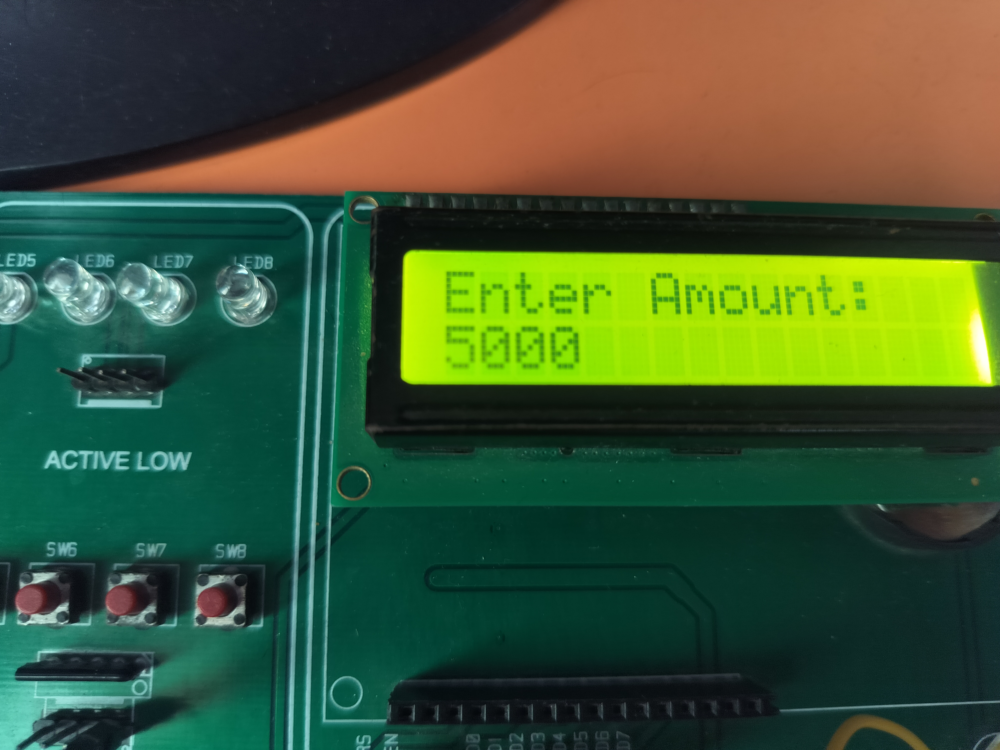 | Numeric amount entered via keypad on LCD[cite: 16, 24] |
| **4a** | **Withdraw Success** | 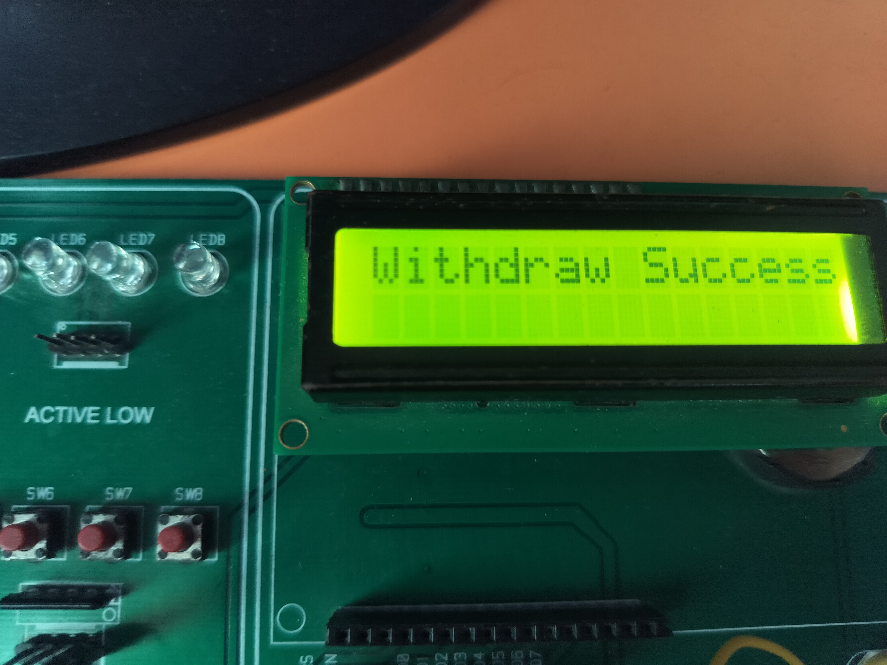 | Cash withdrawal confirmation on LCD[cite: 16, 24] |
| **4b** | **Deposit Success** | 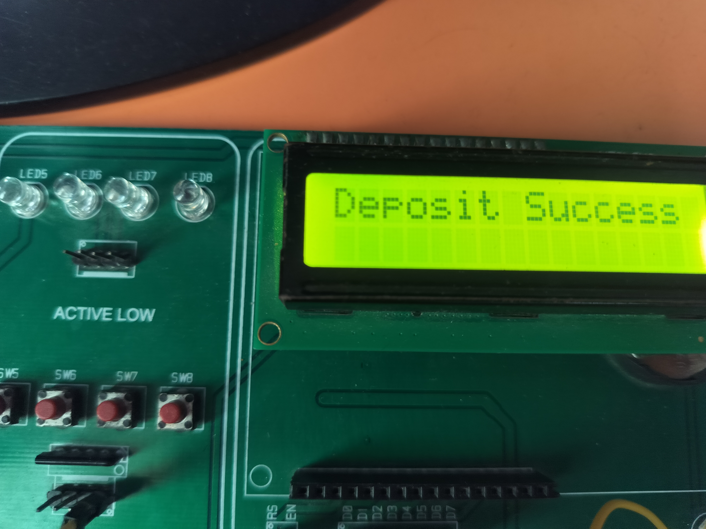 | Cash deposit confirmation on LCD[cite: 16, 24] |

---

### 3. UART0 Serial Output

| Serial Log Output |
| :---: |
| 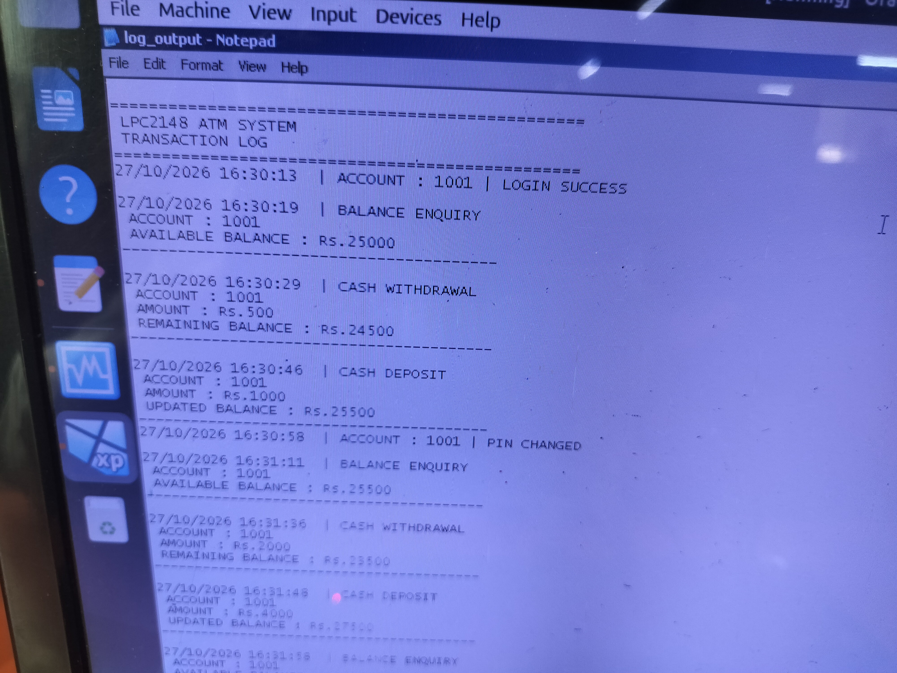 *UART0 serial terminal log output* |

## 🛠️ Challenges Faced

1. **Keypad Input Handling**
   Handling keypad input across different screens required consistent key mapping and input handling. The keypad logic was refined to support navigation, digit entry, correction, confirmation, and cancellation during different operations.
2. **RTC Time Formatting**
   The RTC values were initially displayed without leading zeros. For example, an hour value of 8 appeared as 8 instead of 08. Display formatting was adjusted to maintain a consistent HH:MM:SS representation.
3. **Interrupt Handling and Main-Loop Coordination**
   Handling RTC-related events required understanding the difference between executing operations inside an interrupt service routine and using an interrupt flag to notify the main program. The approach was refined to keep interrupt handling short and perform the required processing in the main program.
4. **Peripheral Integration**
   Integrating the LCD, keypad, RTC, and UART into one application required coordinating input processing, display updates, transaction logic, and serial logging without disrupting the user interaction flow.

---

## 🚀 Future Enhancements

- **Persistent account data**: Store account balance and PIN in non-volatile memory so data is retained after power loss or reset.
- **Multiple user accounts**: Support multiple accounts with independent PINs and balances.
- **Improved authentication**: Add retry limits, temporary lockout, and stronger PIN-change validation.
- **Persistent transaction history**: Store transaction records in EEPROM or another non-volatile storage medium instead of retaining them only in RAM.
- **Improved input validation**: Handle invalid inputs, boundary conditions, and unexpected keypad operations more robustly.
- **Modular architecture**: Further separate authentication, account management, transaction processing, display handling, and peripheral drivers.
- **Enhanced UART diagnostics**: Provide structured transaction logs and debugging information to simplify troubleshooting and firmware analysis.
